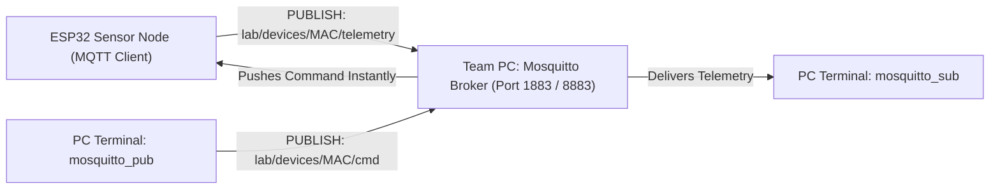
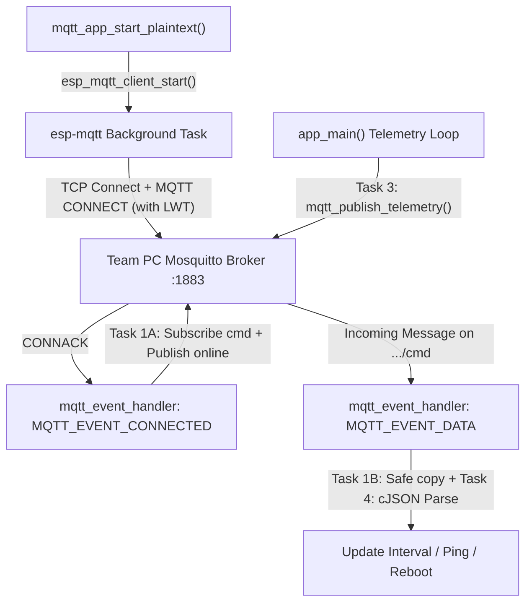
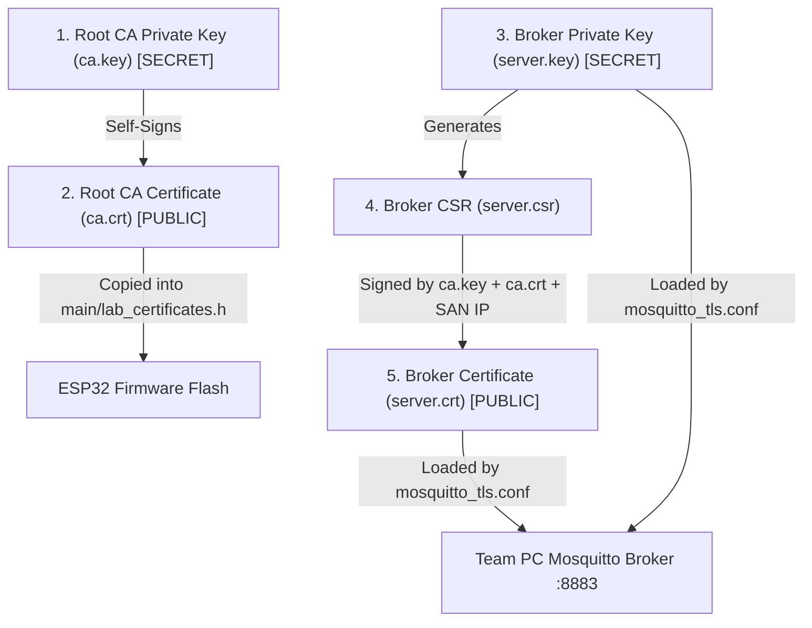

# Hands-On Lab Guide (Session 2): MQTT Protocol, Local Broker, PKI & MQTT over TLS (`mqtts://`)

**Duration:** 3 Hours (180 Minutes)  
**Target Framework:** ESP-IDF (v6.x / v5.x)  
**Prerequisites:** Completion of Session 1 (Wi-Fi Station Association & `cJSON` Serialization/Parsing)

---

## Official API & Tooling Documentation Reference

Use these verified official documentation links while completing the coding tasks and PKI exercises:

- **ESP-MQTT & ESP-IDF Core APIs:**
  - [ESP-MQTT Client Programming Guide (ESP-IDF Stable Docs)](https://docs.espressif.com/projects/esp-idf/en/stable/esp32/api-reference/protocols/mqtt.html)
  - [ESP-MQTT Standalone Component API Reference (`espressif.github.io/esp-mqtt`)](https://espressif.github.io/esp-mqtt/)
  - [ESP Component Registry: `espressif/mqtt`](https://components.espressif.com/components/espressif/mqtt)
  - [ESP-TLS API Reference (Server Verification & mTLS)](https://docs.espressif.com/projects/esp-idf/en/stable/esp32/api-reference/protocols/esp_tls.html)
  - [ESP-IDF Event Loop Library (`esp_event`)](https://docs.espressif.com/projects/esp-idf/en/stable/esp32/api-reference/system/esp_event.html)
- **JSON Serialization & Parsing (`cJSON`):**
  - [ESP Component Registry: `espressif/cjson`](https://components.espressif.com/components/espressif/cjson)
  - [DaveGamble/cJSON Official Library Documentation & API Usage](https://github.com/DaveGamble/cJSON)
- **Eclipse Mosquitto Broker & CLI Clients:**
  - [`mosquitto` Broker Daemon Manpage (`mosquitto-8`)](https://mosquitto.org/man/mosquitto-8.html)
  - [`mosquitto.conf` Configuration File Reference (`listener`, `cafile`, `certfile`, `keyfile`)](https://mosquitto.org/man/mosquitto-conf-5.html)
  - [`mosquitto_pub` CLI Publisher Manpage](https://mosquitto.org/man/mosquitto_pub-1.html)
  - [`mosquitto_sub` CLI Subscriber Manpage](https://mosquitto.org/man/mosquitto_sub-1.html)
- **OpenSSL PKI & X.509 Certificate Commands:**
  - [`openssl genrsa` — RSA Private Key Generation](https://docs.openssl.org/master/man1/openssl-genrsa/)
  - [`openssl req` — PKCS#10 Certificate Signing Request & Self-Signed Root CA](https://docs.openssl.org/master/man1/openssl-req/)
  - [`openssl x509` — Certificate Display, Signing & `subjectAltName` Extensions](https://docs.openssl.org/master/man1/openssl-x509/)

---

## 3-Hour Lab Schedule & Pacing

| Time | Module | Topic | Deliverable / Checkpoint |
| :--- | :--- | :--- | :--- |
| **0:00 – 0:40** *(40m)* | **Module 1** | **MQTT Architecture & Local PC Mosquitto Broker Setup** | Each student team runs a local Mosquitto broker on their PC (`Port 1883`) and verifies Pub/Sub, QoS levels, and topic wildcards (`+`, `#`) via CLI. |
| **0:40 – 1:25** *(45m)* | **Module 2** | **Plaintext MQTT Client, LWT & Remote Control (Coding Tasks 1–4)** | Students implement Tasks 1–4 in [main/mqtt_lab.c](file:///home/ibeto87/Wifi_MQTT/main/mqtt_lab.c), stream JSON telemetry from ESP32 to their PC, and dynamically change the reporting interval via JSON commands. |
| **1:25 – 1:35** *(10m)* | *Break* | — | — |
| **1:35 – 2:20** *(45m)* | **Module 3** | **Public/Private Keys, X.509 PKI & Self-Signed OpenSSL Certificates** | Teams generate their own Root CA (`ca.key`, `ca.crt`) and Broker Certificate (`server.key`, `server.crt` with `subjectAltName = IP:<PC_IP>`), and switch Mosquitto to TLS (`Port 8883`). |
| **2:20 – 3:00** *(40m)* | **Module 4** | **Securing ESP32 with MQTTS (Coding Task 5), Fault Injection & mTLS Bonus** | Students paste `ca.crt` into [main/lab_certificates.h](file:///home/ibeto87/Wifi_MQTT/main/lab_certificates.h), implement Task 5 (`mqtt_app_start_tls`), test rogue CA / wrong IP rejection, and optionally enable Mutual TLS (mTLS). |

---

## Project Architecture & Credentials Separation

In real-world embedded firmware, **never hardcode network credentials or cryptographic certificates inside application logic files (`main.c`)**. In this lab branch (`mqtt-mqtts-lab`), configuration and secrets are isolated into dedicated header files:

- **[main/lab_credentials.h](file:///home/ibeto87/Wifi_MQTT/main/lab_credentials.h)** — Contains your Wi-Fi SSID/Password, team ID, and your PC broker's IPv4 URIs (`LAB_MQTT_BROKER_PLAIN_URI` and `LAB_MQTT_BROKER_TLS_URI`).
- **[main/lab_certificates.h](file:///home/ibeto87/Wifi_MQTT/main/lab_certificates.h)** — Contains `LAB_CA_CERT_PEM` (your team's self-signed Root CA certificate) and optional `LAB_CLIENT_CERT_PEM` / `LAB_CLIENT_KEY_PEM` for the Mutual TLS bonus challenge.
- **[main/mqtt_lab.h](file:///home/ibeto87/Wifi_MQTT/main/mqtt_lab.h) & [main/mqtt_lab.c](file:///home/ibeto87/Wifi_MQTT/main/mqtt_lab.c)** — Contains the **5 Student Coding Tasks (`TODO` placeholders)** you will write today.
- **[broker_setup/mosquitto_plain.conf](file:///home/ibeto87/Wifi_MQTT/broker_setup/mosquitto_plain.conf) & [broker_setup/mosquitto_tls.conf](file:///home/ibeto87/Wifi_MQTT/broker_setup/mosquitto_tls.conf)** — Ready-to-use Mosquitto configuration files for your team's PC.

---

## Module 1: MQTT Protocol Architecture & Local Broker Setup (40 mins)

### 1. Scaffolded Concept Explanation

In Session 1, we used **HTTP REST APIs**. While HTTP is great for request/response queries, it has major drawbacks for real-time IoT devices:
- **HTTP is Strictly Client-Initiated:** How do you send a command *to* an ESP32 behind a NAT firewall using HTTP? The ESP32 would have to constantly poll the server (`GET /commands` every second), wasting bandwidth and battery.
- **High Header Overhead:** Every HTTP transaction repeats hundreds of bytes of ASCII headers over a new TCP handshake.

**MQTT (Message Queuing Telemetry Transport)** solves both problems using a **Publish / Subscribe (Pub/Sub)** architecture over a **single persistent TCP connection**:



#### Core MQTT Mechanisms You Must Know:
1. **Topics & Wildcards:**
   - Topics are UTF-8 strings separated by forward slashes (`/`), forming a hierarchy: `lab/devices/2805A5749288/telemetry`.
   - **Single-Level Wildcard (`+`):** Matches exactly one hierarchy level. Example: `lab/devices/+/telemetry` subscribes to telemetry from *every* ESP32 in the room.
   - **Multi-Level Wildcard (`#`):** Matches all remaining levels (must be at the end). Example: `lab/devices/#` receives telemetry, commands, and status messages for all devices.
2. **Quality of Service (QoS Levels):**
   - **QoS 0 (*At most once*):** Fire-and-forget. No MQTT-level acknowledgment (relies only on underlying TCP).
   - **QoS 1 (*At least once*):** Sender stores the packet until it receives a `PUBACK` from the broker. Guarantees delivery, though duplicates are possible on retry.
   - **QoS 2 (*Exactly once*):** 4-part handshake (`PUBLISH -> PUBREC -> PUBREL -> PUBCOMP`). Highest reliability, highest latency.
3. **Retained Messages (`retain = 1`):**
   - Normally, if a subscriber connects *after* a message was published, it misses it.
   - If a publisher sets `retain = 1`, the broker stores the **last known good message** on that topic and delivers it *immediately* to any future subscriber (ideal for `"online"` / `"offline"` status topics!).
4. **Last Will and Testament (LWT):**
   - How do we know if an ESP32 lost power or crashed if it can no longer send a `"disconnecting"` packet?
   - During the initial `CONNECT` packet, the ESP32 registers an **LWT message** (e.g., `{"status":"offline_unexpected"}` on `lab/devices/<MAC>/status` with `retain = 1`) with the broker.
   - If the ESP32's keep-alive timer expires without a `PINGREQ`, **the broker automatically publishes the LWT message on behalf of the dead ESP32!**

---

### 2. Hands-On Exercise 1: Run Your Team's Local Mosquitto Broker

1. **Install Mosquitto & CLI Clients on your Team PC:**
   - **Ubuntu / Debian:** `sudo apt install mosquitto mosquitto-clients`
   - **Arch Linux:** `sudo pacman -S mosquitto`
   - **macOS (Homebrew):** `brew install mosquitto`
2. **Find your PC's Local Wi-Fi IPv4 Address:**
   ```bash
   ip -4 addr show
   ```
   *(Note down your PC's IP on the classroom Wi-Fi, e.g., `192.168.1.100` or `10.x.x.x`).*
3. **Stop any background system Mosquitto service** so you can run Mosquitto interactively in your terminal with verbose logs:
   ```bash
   sudo systemctl stop mosquitto
   ```
4. **Launch Mosquitto in Plaintext Mode** using our provided config file:
   ```bash
   mosquitto -c broker_setup/mosquitto_plain.conf -v
   ```
5. **Verify Pub/Sub locally across two new terminal tabs:**
   - **Terminal 2 (Subscriber):**
     ```bash
     mosquitto_sub -h localhost -p 1883 -t "lab/devices/#" -v
     ```
   - **Terminal 3 (Publisher):**
     ```bash
     mosquitto_pub -h localhost -p 1883 -t "lab/devices/test/telemetry" -m '{"temp":24.5}'
     ```
   Confirm that Terminal 2 prints `lab/devices/test/telemetry {"temp":24.5}` and Terminal 1 (Broker) logs the `PUBLISH` transaction!

---

## Module 2: Plaintext MQTT Client, LWT & Remote Control (45 mins)

### 1. Scaffolded Concept Explanation

In ESP-IDF, the `esp-mqtt` component runs its own background FreeRTOS task that manages the TCP socket, MQTT keep-alive pings (`PINGREQ` / `PINGRESP`), and automatic reconnection. Your application interacts with it asynchronously through `mqtt_event_handler()`.

> [!CAUTION]
> **Critical Embedded C Pitfall (`MQTT_EVENT_DATA`):**
> When `MQTT_EVENT_DATA` fires, `event->topic` and `event->data` point directly into the network receive buffer and **are NOT null-terminated (`'\0'`)!**
> Always use `event->topic_len` and `event->data_len` to copy them into a null-terminated local buffer before passing them to `cJSON_Parse()` or `ESP_LOGI("%s")`!



---

### 2. Student Coding Tasks 1–4 (in [main/mqtt_lab.c](file:///home/ibeto87/Wifi_MQTT/main/mqtt_lab.c))

Open [main/lab_credentials.h](file:///home/ibeto87/Wifi_MQTT/main/lab_credentials.h) first and update:
- `LAB_WIFI_SSID` and `LAB_WIFI_PASS`
- `LAB_MQTT_BROKER_PLAIN_URI` (`"mqtt://<YOUR_PC_IP>:1883"`)

Now open [main/mqtt_lab.c](file:///home/ibeto87/Wifi_MQTT/main/mqtt_lab.c) and complete **Tasks 1 through 4**:

#### Coding Task 1 (`mqtt_event_handler`)
> **API Reference:** See [`esp_mqtt_event_t`](https://docs.espressif.com/projects/esp-idf/en/stable/esp32/api-reference/protocols/mqtt.html#_CPPv416esp_mqtt_event_t), [`esp_mqtt_client_subscribe()`](https://docs.espressif.com/projects/esp-idf/en/stable/esp32/api-reference/protocols/mqtt.html#_CPPv425esp_mqtt_client_subscribe24esp_mqtt_client_handle_tPKci), and [`esp_mqtt_client_publish()`](https://docs.espressif.com/projects/esp-idf/en/stable/esp32/api-reference/protocols/mqtt.html#_CPPv423esp_mqtt_client_publish24esp_mqtt_client_handle_tPKcPKciii) in the ESP-IDF MQTT documentation.
- **Task 1A (`MQTT_EVENT_CONNECTED`):**
  1. Subscribe to `s_topic_cmd` with QoS `1` using `esp_mqtt_client_subscribe(client, s_topic_cmd, 1);`.
  2. Publish a retained birth message `"{\"status\":\"online\"}"` to `s_topic_status` with QoS `1` and `retain = 1` using `esp_mqtt_client_publish()`.
- **Task 1B (`MQTT_EVENT_DATA`):**
  1. Copy `event->topic` (using `event->topic_len`) and `event->data` (using `event->data_len`) into null-terminated stack buffers `topic_buf[128]` and `data_buf[512]`.
  2. Hint: `snprintf(data_buf, sizeof(data_buf), "%.*s", event->data_len, event->data);` safely bounds and null-terminates in one line!
  3. Call `mqtt_process_incoming_command(topic_buf, data_buf);`.

#### Coding Task 2 (`mqtt_app_start_plaintext`)
> **API Reference:** See [`esp_mqtt_client_config_t`](https://docs.espressif.com/projects/esp-idf/en/stable/esp32/api-reference/protocols/mqtt.html#_CPPv424esp_mqtt_client_config_t), [`esp_mqtt_client_init()`](https://docs.espressif.com/projects/esp-idf/en/stable/esp32/api-reference/protocols/mqtt.html#_CPPv420esp_mqtt_client_initPK24esp_mqtt_client_config_t), and [`esp_mqtt_client_register_event()`](https://docs.espressif.com/projects/esp-idf/en/stable/esp32/api-reference/protocols/mqtt.html#_CPPv430esp_mqtt_client_register_event24esp_mqtt_client_handle_t18esp_mqtt_event_id_t19esp_event_handler_tPv).
- Initialize `esp_mqtt_client_config_t mqtt_cfg = {0};`.
- Set `mqtt_cfg.broker.address.uri = LAB_MQTT_BROKER_PLAIN_URI;`.
- Configure Last Will and Testament inside `mqtt_cfg.session.last_will`:
  - `.topic = s_topic_status`
  - `.msg = "{\"status\":\"offline_unexpected\"}"`
  - `.qos = 1`, `.retain = 1`
- Call `esp_mqtt_client_init()`, `esp_mqtt_client_register_event()`, and `esp_mqtt_client_start()`.

#### Coding Task 3 (`mqtt_publish_telemetry`)
> **API Reference:** See [`cJSON_CreateObject` & `cJSON_PrintUnformatted`](https://github.com/DaveGamble/cJSON#printing) in the official cJSON documentation.
- Create a `cJSON` object containing `"student_id"`, `"mac"`, `"rssi_dbm"`, `"uptime_sec"`, and `"free_heap"`.
- Serialize with `cJSON_PrintUnformatted()`, publish to `s_topic_telemetry` (QoS `1`, `retain = 0`), and free both the `cJSON` object (`cJSON_Delete`) and the serialized string (`free`).

#### Coding Task 4 (`mqtt_process_incoming_command`)
> **API Reference:** See [`cJSON_Parse` & `cJSON_GetObjectItemCaseSensitive`](https://github.com/DaveGamble/cJSON#parsing) in the official cJSON documentation.
- Parse the incoming JSON string using `cJSON_Parse(payload)`.
- Inspect the `"action"` string field:
  - `"set_interval"`: Read integer field `"value"` (between `1` and `60`), update `s_telemetry_interval_sec`, and publish an ACK JSON to `s_topic_status`.
  - `"ping"`: Publish `"{\"status\":\"pong\"}"` to `s_topic_status`.
  - `"reboot"`: Publish `"{\"status\":\"rebooting\"}"`, free the JSON tree, and call `esp_restart()`.

---

### 3. Testing & Verification (Module 2 Checkpoint)

1. Build, flash, and monitor your ESP32:
   ```bash
   idf.py build flash monitor
   ```
2. In your PC's subscriber terminal (`mosquitto_sub -h localhost -p 1883 -t "lab/devices/#" -v`), verify you see:
   - `lab/devices/<MAC>/status {"status":"online"}`
   - `lab/devices/<MAC>/telemetry {"student_id":...}` every 10 seconds!
3. **Test Remote Command Execution:** Send a command from your PC to speed up telemetry to every 2 seconds:
   ```bash
   mosquitto_pub -h localhost -p 1883 -t "lab/devices/<YOUR_ESP32_MAC>/cmd" -m '{"action":"set_interval","value":2}'
   ```
4. **Test Last Will & Testament (LWT):** Unplug your ESP32's USB cable abruptly. Wait ~15 seconds and watch your Mosquitto subscriber terminal automatically receive `{"status":"offline_unexpected"}` from the broker!

---

## Module 3: Public/Private Keys, X.509 PKI & Self-Signed OpenSSL Certificates (45 mins)

### 1. Scaffolded Concept Explanation: How TLS & PKI Actually Work

Why is Module 2 dangerous in production? If you open **Wireshark** on the classroom Wi-Fi and filter by `mqtt`, anyone on the network can read your telemetry payloads, spoof commands to reboot your ESP32, or steal passwords in plaintext.

**TLS (Transport Layer Security)** provides three guarantees before a single MQTT packet is sent:
1. **Authentication (Who are you?):** Prevents Man-in-the-Middle (MitM) imposter brokers using **Asymmetric Cryptography** and **X.509 Certificates**.
2. **Confidentiality (Encryption):** Negotiates an ephemeral symmetric session key (e.g., AES-GCM) so nobody can eavesdrop.
3. **Integrity (MAC):** Ensures packets cannot be altered in transit.

#### Public Key Infrastructure (PKI) Building Blocks:
| Concept | File in Our Lab | Public or Secret? | What Role Does It Play? |
| :--- | :--- | :--- | :--- |
| **Root CA Private Key** | `ca.key` | **STRICTLY SECRET** (Never leaves PC) | Used *only* to mathematically sign certificates (`ca.crt` and `server.crt`). Anyone who steals `ca.key` can forge any broker certificate! |
| **Root CA Certificate** | `ca.crt` | **PUBLIC** (Embedded in ESP32 Flash) | Contains the Root CA's **Public Key**. The ESP32 uses `ca.crt` to verify that the broker's `server.crt` was genuinely signed by your team's `ca.key`. |
| **Broker Private Key** | `server.key` | **SECRET** (Used only by Mosquitto) | Proves during the TLS handshake that the Mosquitto PC actually owns the identity claimed inside `server.crt`. |
| **Certificate Signing Request** | `server.csr` | Temporary | A formal request containing the broker's Public Key and identity (`CN` / `IP`) sent to the CA to be signed. |
| **Broker Server Certificate** | `server.crt` | **PUBLIC** (Sent by Mosquitto during TLS Hello) | The broker's digital passport: contains the broker's Public Key + IP address (`subjectAltName`), cryptographically signed by `ca.key`. |



> [!IMPORTANT]
> **Why `subjectAltName = IP:<YOUR_PC_IP>` is Mandatory!**
> Modern TLS stacks—including **mbedTLS** on the ESP32—do not just check if `server.crt` is signed by `ca.crt`. They also verify that the **hostname or IP address** in your URI (`mqtts://192.168.1.100:8883`) matches the **Subject Alternative Name (`SAN`)** inside `server.crt`. If they don't match, mbedTLS aborts with `cert_verify_flags = 0x4 (MBEDTLS_X509_BADCERT_CN_MISMATCH)`!

---

### 2. Hands-On Exercise 3: Generate Your Team's PKI Certificates with OpenSSL

Run the following commands from the project root directory (`/home/ibeto87/Wifi_MQTT`):

#### Step 1: Create the `broker_setup/certs` directory
```bash
mkdir -p broker_setup/certs
cd broker_setup/certs
```

#### Step 2: Generate the Root CA Private Key (`ca.key`) and Self-Signed Root Certificate (`ca.crt`)
```bash
# 1. Generate a 2048-bit RSA Private Key for your Team's Root CA
openssl genrsa -out ca.key 2048

# 2. Self-sign the Root CA Certificate (valid for 3650 days / 10 years)
openssl req -x509 -new -nodes -key ca.key -sha256 -days 3650 \
  -subj "/C=CO/ST=Caldas/L=Manizales/O=IoT-Lab-CA/CN=IoT-Lab-Root-CA" \
  -out ca.crt
```

#### Step 3: Generate the Mosquitto Broker Private Key (`server.key`) and CSR (`server.csr`)
Replace `192.168.1.100` below with **your PC's actual Wi-Fi IPv4 address**:
```bash
# 3. Generate a 2048-bit RSA Private Key for the Mosquitto Broker
openssl genrsa -out server.key 2048

# 4. Create the Certificate Signing Request (CSR) with your PC's IP as Common Name
openssl req -new -key server.key \
  -subj "/C=CO/ST=Caldas/L=Manizales/O=IoT-Lab-Broker/CN=192.168.1.100" \
  -out server.csr
```

#### Step 4: Sign the Broker Certificate (`server.crt`) with `subjectAltName`
Replace `192.168.1.100` with **your PC's actual Wi-Fi IPv4 address**:
```bash
# 5. Create the X.509 v3 extension file binding your PC's IPv4 address
echo "subjectAltName = IP:192.168.1.100,IP:127.0.0.1" > san.ext

# 6. Sign server.csr using your Root CA (ca.crt + ca.key) to produce server.crt
openssl x509 -req -in server.csr -CA ca.crt -CAkey ca.key -CAcreateserial \
  -out server.crt -days 365 -sha256 -extfile san.ext
```

#### Step 5: Inspect Your Generated Certificate
Verify that your `Subject Alternative Name` IP and `Issuer` are properly embedded:
```bash
openssl x509 -in server.crt -noout -text | grep -A 2 -E "Issuer:|Subject:|Alternative Name"
cd ../..
```

#### Step 6: Launch Mosquitto in TLS Mode (`Port 8883`) and Test via CLI
```bash
# Terminal 1: Start Mosquitto with TLS enabled on Port 8883
mosquitto -c broker_setup/mosquitto_tls.conf -v

# Terminal 2: Subscribe over TLS using ca.crt (use your PC's IP!)
mosquitto_sub -h 192.168.1.100 -p 8883 --cafile broker_setup/certs/ca.crt -t "lab/devices/#" -v
```

---

## Module 4: Securing ESP32 with MQTTS (`Coding Task 5`) & Security Verification (40 mins)

### 1. Hands-On Coding Task 5: Enable MQTTS on ESP32

1. **Embed Your Team's Root CA Certificate:**
   - Open `broker_setup/certs/ca.crt` in a text editor.
   - Copy the PEM block (`-----BEGIN CERTIFICATE-----` through `-----END CERTIFICATE-----`) into `LAB_CA_CERT_PEM` inside [main/lab_certificates.h](file:///home/ibeto87/Wifi_MQTT/main/lab_certificates.h) (making sure each line ends with `\n"`).
2. **Verify Your Broker TLS URI:**
   - Open [main/lab_credentials.h](file:///home/ibeto87/Wifi_MQTT/main/lab_credentials.h) and set:
     ```c
     #define LAB_MQTT_BROKER_TLS_URI     "mqtts://<YOUR_PC_IP>:8883"
     ```
3. **Complete Coding Task 5 (`mqtt_app_start_tls` in [main/mqtt_lab.c](file:///home/ibeto87/Wifi_MQTT/main/mqtt_lab.c)):**
   - **API Reference:** See [MQTT over TLS (`broker.verification_t`)](https://docs.espressif.com/projects/esp-idf/en/stable/esp32/api-reference/protocols/mqtt.html#_CPPv4N24esp_mqtt_client_config_t7broker_t14verification_tE) and [ESP-TLS Certificate Verification](https://docs.espressif.com/projects/esp-idf/en/stable/esp32/api-reference/protocols/esp_tls.html#tls-server-verification).
   - Set `mqtt_cfg.broker.address.uri = LAB_MQTT_BROKER_TLS_URI;`.
   - Set `mqtt_cfg.broker.verification.certificate = LAB_CA_CERT_PEM;`.
   - Include the same LWT configuration on `s_topic_status` as in Task 2.
   - Initialize, register `mqtt_event_handler`, and start the client!
4. **Switch the Lab Toggle in [main/main.c](file:///home/ibeto87/Wifi_MQTT/main/main.c):**
   ```c
   #define LAB_ENABLE_MQTT_PLAINTEXT   0
   #define LAB_ENABLE_MQTT_TLS         1
   ```
5. Build, flash, and monitor (`idf.py build flash monitor`). Confirm that the TLS handshake succeeds on Port `8883` and telemetry flows securely!

---

### 2. Security Fault-Injection Experiments (Required Checkpoints)

Perform these two experiments and record the exact mbedTLS error codes printed by `MQTT_EVENT_ERROR`:

1. **Experiment A — Untrusted / Rogue CA Attack:**
   - In [main/lab_certificates.h](file:///home/ibeto87/Wifi_MQTT/main/lab_certificates.h), change a single character in the middle of `LAB_CA_CERT_PEM` (or swap `ca.crt` with a neighboring team's `ca.crt`).
   - Reflash the ESP32. Observe how mbedTLS rejects the connection with `cert_verify_flags: 0x8 (MBEDTLS_X509_BADCERT_NOT_TRUSTED)`.
2. **Experiment B — IP / Hostname Spoofing (`CN_MISMATCH`):**
   - Restore your valid `LAB_CA_CERT_PEM`, but regenerate `server.crt` with `IP:10.99.99.99` in `san.ext` instead of your PC's real IP.
   - Restart Mosquitto and observe how the ESP32 rejects the certificate with `cert_verify_flags: 0x4 (MBEDTLS_X509_BADCERT_CN_MISMATCH)` even though the cryptographic signature is valid!

---

### 3. Bonus Challenge: Mutual TLS (`mTLS`) Client Certificate Authentication

In standard TLS, the ESP32 verifies the broker's identity, but the broker accepts any client (`require_certificate false`). In **Mutual TLS (`mTLS`)**, the broker also requires the ESP32 to present a client certificate (`client.crt`) signed by `ca.crt`:

1. **Generate the ESP32 Client Key & Certificate on your PC:**
   ```bash
   cd broker_setup/certs
   openssl genrsa -out client.key 2048
   openssl req -new -key client.key -subj "/C=CO/O=IoT-Lab-Client/CN=esp32_team_01" -out client.csr
   openssl x509 -req -in client.csr -CA ca.crt -CAkey ca.key -CAcreateserial -out client.crt -days 365 -sha256
   cd ../..
   ```
2. **Enable mTLS in [broker_setup/mosquitto_tls.conf](file:///home/ibeto87/Wifi_MQTT/broker_setup/mosquitto_tls.conf):**
   Uncomment `require_certificate true` and `use_identity_as_username true`, then restart Mosquitto.
3. **Add Client Credentials to ESP32:**
   - Paste `client.crt` and `client.key` into `LAB_CLIENT_CERT_PEM` and `LAB_CLIENT_KEY_PEM` in [main/lab_certificates.h](file:///home/ibeto87/Wifi_MQTT/main/lab_certificates.h).
   - In `mqtt_app_start_tls()` ([main/mqtt_lab.c](file:///home/ibeto87/Wifi_MQTT/main/mqtt_lab.c)), set:
     ```c
     mqtt_cfg.credentials.authentication.certificate = LAB_CLIENT_CERT_PEM;
     mqtt_cfg.credentials.authentication.key         = LAB_CLIENT_KEY_PEM;
     ```
   - Flash and verify that Mosquitto logs your ESP32 connecting authenticated as username `esp32_team_01`!
